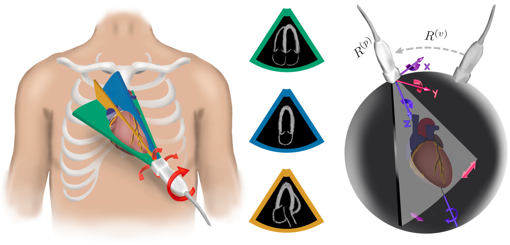
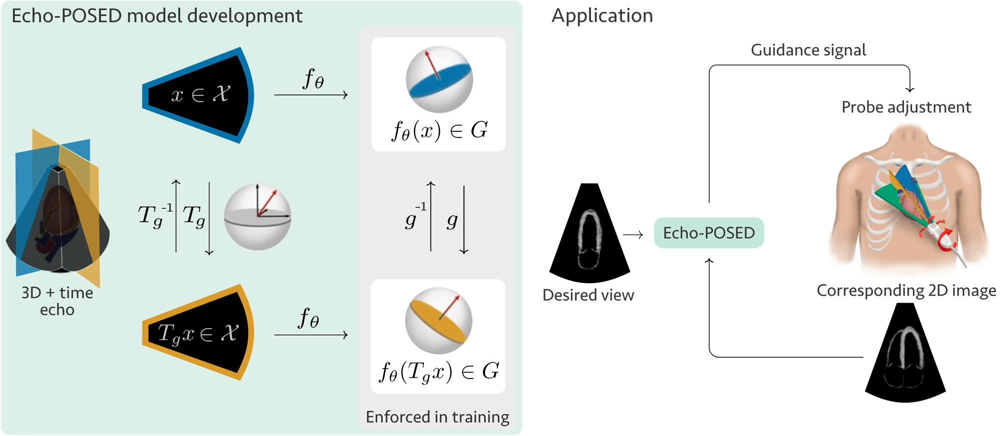
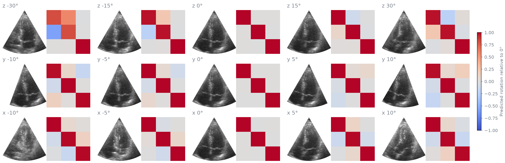

<h1 align="center">Echo-POSED</h1>

<p align="center">
  <strong>Geometric Self-Distillation for Echocardiography Guidance</strong>
</p>

<p align="center">
  <a href="https://arxiv.org/abs/2606.02634">
    
  </a>
  <a href="https://huggingface.co/datasets/Ahus-AIM/EchoXFlow">
    
  </a>
  <a href="https://github.com/Ahus-AIM/Echo-POSED/actions/workflows/ci.yml">
    
  </a>
</p>

<p align="center">
  <picture>
    <source media="(prefers-color-scheme: dark)" srcset="assets/probe_pose_geometry-dark.webp">
    
  </picture>
</p>

Echo-POSED estimates probe rotation and orbital tilt from a single B-mode frame. It learns from virtual probe movements in 3D EchoXFlow recordings and uses ensemble disagreement to estimate uncertainty.

## Installation

Requires Python 3.13 and [uv](https://docs.astral.sh/uv/).

```bash
git clone https://github.com/Ahus-AIM/Echo-POSED.git
cd Echo-POSED
uv sync --locked
```

Download `echo-posed.pth` from the [v0.1.0 release](https://github.com/Ahus-AIM/Echo-POSED/releases/tag/v0.1.0) and save it in `checkpoints/`.

You can also download it with the [GitHub CLI](https://cli.github.com/) (`gh`). Run `gh auth login` first if needed.

```bash
gh release download v0.1.0 --pattern echo-posed.pth --dir checkpoints
```

## Quick start

<p align="center">
  <picture>
    <source media="(prefers-color-scheme: dark)" srcset="assets/banner-dark.webp">
    
  </picture>
</p>

### Training

Download [EchoXFlow](https://github.com/Ahus-AIM/EchoXFlow), then train and evaluate on a CUDA GPU.

```bash
export ECHOXFLOW_DATA_ROOT=/path/to/EchoXFlow/data
uv run echo-posed train --device cuda --output runs/trained.pth
uv run echo-posed evaluate --weights runs/trained.pth --device cuda --output runs/held-out.json
```

### Inference

Save this as `quickstart.py` and run `uv run python quickstart.py`.

```python
import math

import torch

from echo_posed.data import load_reference_volume
from echo_posed.imaging import scan_convert, slice_volume
from echo_posed.model import INPUT_SIZE, Ensemble
from echo_posed.plotting import save_rotation_grid
from echo_posed.pose import probe_rotation

volume, geometry = load_reference_volume("examples/reference_volume.npz")
print(volume.shape)  # torch.Size([60, 110, 501]): elevation, azimuth, depth

# One probe axis per row, five angles in degrees
rows = {"z": (-30, -15, 0, 15, 30), "y": (-10, -5, 0, 5, 10), "x": (-10, -5, 0, 5, 10)}
turns = [(axis, angle) for axis, angles in rows.items() for angle in angles]
degrees = torch.tensor([[angle * (axis == name) for name in "xyz"] for axis, angle in turns])
probe = probe_rotation(torch.deg2rad(degrees.float()))
poses = torch.stack((torch.eye(3).expand_as(probe), probe), dim=1)  # no orbital tilt

width, depth = math.pi / 3, geometry.depth_end  # radians, metres
volumes = volume.expand(len(poses), -1, -1, -1)
sectors = slice_volume(volumes, geometry, poses, size=INPUT_SIZE, width=width, depth=depth)
images = scan_convert(sectors, width=width, depth_start=0, depth_end=depth, size=INPUT_SIZE)

model = Ensemble.load("checkpoints/echo-posed.pth")
rotations = model(images).rotations[:, 1]  # [15, 3, 3] probe rotations
predicted = rotations[2].T @ rotations  # relative to the unrotated slice, which becomes the identity

titles = [f"{axis} {angle}°" for axis, angle in turns]
save_rotation_grid(
    "runs/quickstart.png", sectors, predicted, titles, geometry=geometry, poses=poses, width=width, depth=depth
)
```

<p align="center">
  
</p>

#### Guidance

With `ECHOXFLOW_DATA_ROOT` set, compute the probe correction from a current frame to a target frame. The [guidance example](docs/running.md#guidance-example) illustrates this pair.

```bash
uv run echo-posed guide recording_6c79bf7faa9f883f recording_a22dd88dd7d9058e \
  --current-frame 4 --target-frame 5 --output runs/guidance.json
```

## Documentation

- [Dataset and inference](docs/running.md)
- [Training, evaluation and guidance](docs/reproduce.md)

## Development

```bash
uv run --no-project --with ruff==0.15.20 ruff check .
uv run pytest
```

## License

Echo-POSED is licensed under [CC BY-NC-SA 4.0](LICENSE). The files in `external/pasdeloup/` keep [their own licenses](external/pasdeloup/README.md#license): CC BY-NC 4.0 for the converted weights and PolyForm Noncommercial 1.0.0 for the code.

## Citation

Cite both papers when using Echo-POSED or its pretrained checkpoint. The ensemble was trained on EchoXFlow.

```bibtex
@misc{stenhede_2026_echoposed,
  title         = {{Echo-POSED}: Geometric Self-Distillation for Echocardiography Guidance},
  author        = {Elias Stenhede and Edvart Grüner Bjerke and Joanna Sulkowska and Eivind Bjørkan Orstad and Ole Jakob Elle and Ulysse Côté-Allard and Arian Ranjbar},
  year          = {2026},
  eprint        = {2606.02634},
  archivePrefix = {arXiv},
  primaryClass  = {eess.IV},
  doi           = {10.48550/arXiv.2606.02634},
  url           = {https://arxiv.org/abs/2606.02634}
}

@inproceedings{stenhede_2026_echoxflow,
  title     = {{EchoXFlow}: A Beamspace Echocardiography Dataset for Cardiac Motion, Flow, and Function},
  author    = {Elias Stenhede and Joanna Sulkowska and Eivind Bjørkan Orstad and Henrik Schirmer and Arian Ranjbar},
  booktitle = {Advances in Neural Information Processing Systems (NeurIPS), Evaluations and Datasets Track},
  year      = {2026},
  eprint    = {2605.05447},
  doi       = {10.48550/arXiv.2605.05447},
  url       = {https://arxiv.org/abs/2605.05447}
}
```
