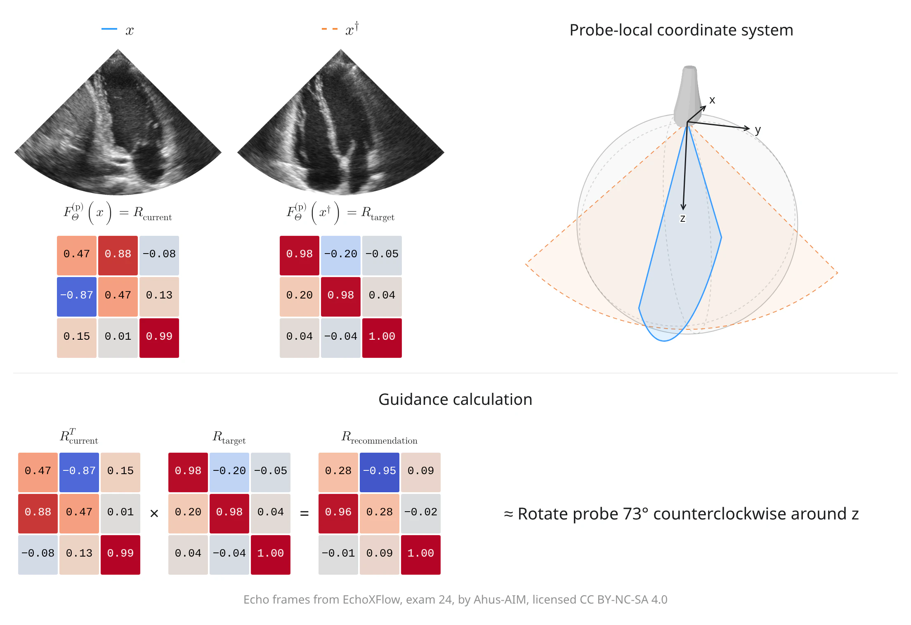

# Dataset and inference

Follow the [README quick start](../README.md#quick-start), then predict a 2D recording.

```bash
uv run echo-posed predict PATH.zarr --output runs/poses.json
```

`uv run echo-posed predict --help` lists the options.

## Guidance example

[](a2c-to-a4c.html)
